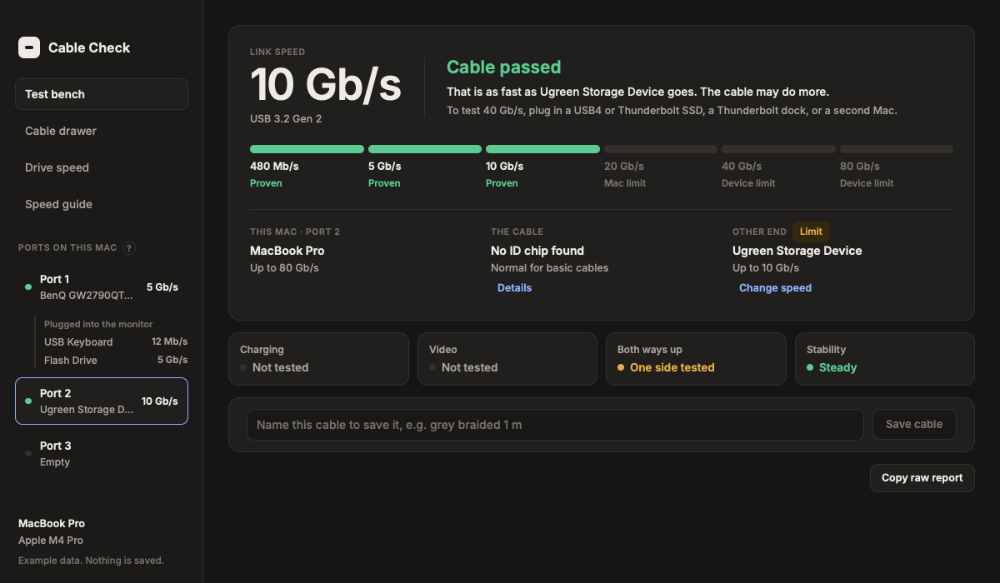
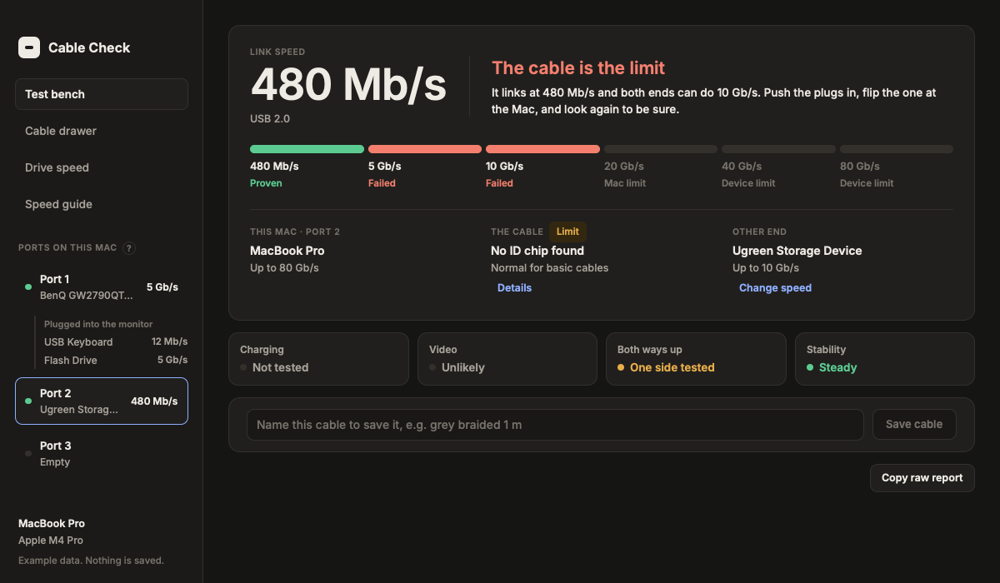
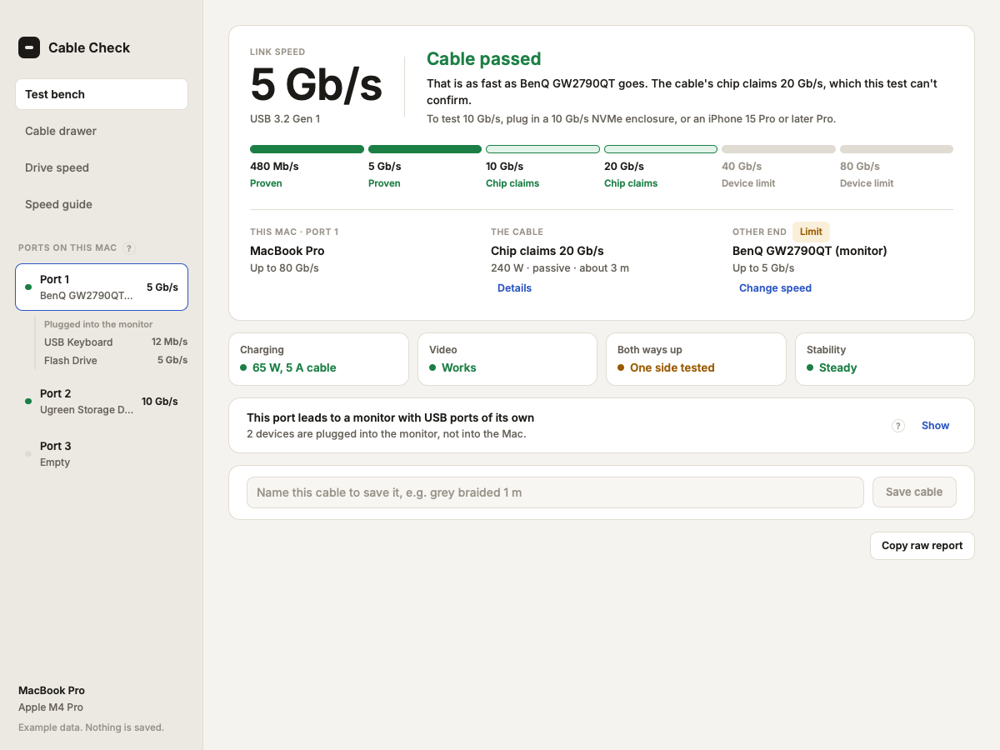
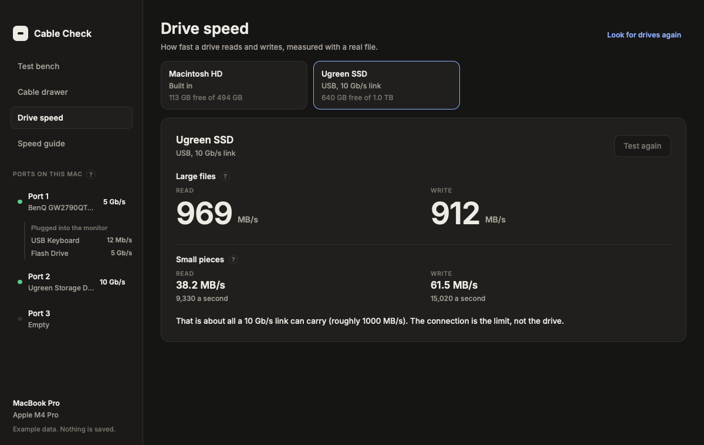
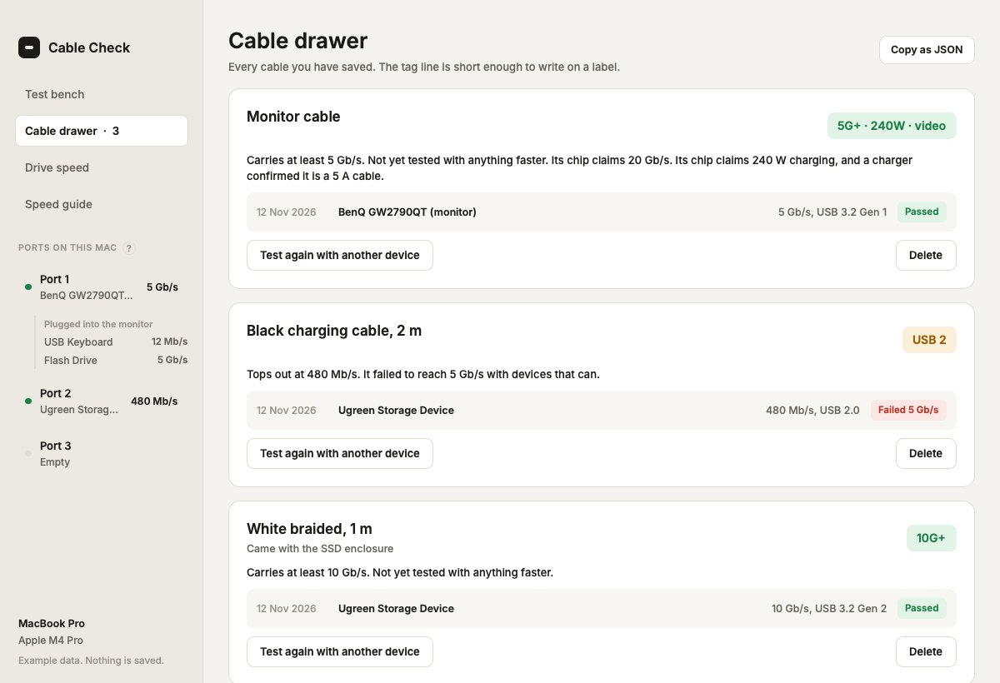

# Cable Check

A macOS app for sorting a drawer of unlabelled USB-C cables. Plug a device into the Mac with a cable and it tells you what the cable carried, what it failed to carry, and what this pair of devices was too slow to test. Built with [Rune](https://github.com/anomalyco/rune).

> **Heads up:** this entire repo is AI-generated slop. Use it at your own risk.



## What it does

- **Grades a cable speed by speed**, from USB 2 (480 Mb/s) to Thunderbolt 5 (80 Gb/s), against what the Mac and the device at the other end can both do.
- **Tells you which part is the limit**: the cable, the device, or the Mac. If the device is too slow to test the cable fully, it says what to plug in instead.
- **Reads the cable's ID chip (e-marker)** and compares its claims with what the link did.
- **Checks charging, video, both plug orientations and link stability.**
- **Groups a monitor's or hub's USB ports** under the monitor, so they aren't mistaken for ports on the Mac.
- **Measures drive speed** for the internal drive and external ones.
- **Keeps a drawer of saved cables** with a short rating you can write on a tag.
- **Explains the jargon** with a tooltip on every term and a speed guide page.

Nothing leaves your Mac. The app makes no network requests.

| | |
|---|---|
|  |  |
|  |  |

## Install

Needs a Mac with Apple silicon, [Rust](https://rustup.rs), and Xcode Command Line Tools (`xcode-select --install`). The first build compiles Rune's renderer and takes a few minutes.

```sh
git clone https://github.com/imran-vz/cable-check.git
cd cable-check
cargo install --path .
cable-check
```

Or run it from the checkout without installing:

```sh
cargo run --release
```

To print what the app sees without opening a window:

```sh
cable-check --scan-json
```

## How a test works

A link has three parts: the Mac's port, the cable, and the device. It runs at the speed of the slowest one. So the app works out the top speed of each end first, then grades the cable against every speed both ends support.

1. Plug a device straight into the Mac with the cable. No hub or dock in between.
2. The port shows up on the test bench within a second. There is no scan button.
3. The bench shows the link speed, a one-line verdict, and a meter with six speeds. Each speed is marked:
   - **Proven**: the link is running at this speed or faster.
   - **Chip claims**: this setup can't test it, but the cable's ID chip says the cable can do it.
   - **Failed**: both ends can do it and the link didn't get there. The cable is the suspect.
   - **Device limit**: the device tops out below this, so the test says nothing about it.
   - **Mac limit**: the port doesn't support it (20 Gb/s USB on any Mac).
   - **Not tested**: the device's top speed isn't known.
4. If the device is the limit, the app says which kind of device would test the next speed up.
5. Name the cable and save it. Test it again with a faster device under the same name and the results combine into one rating.

### Where the device's top speed comes from

The app works it out by itself. In this order: what you picked under "Change speed", a bridge chip the app recognises by USB ID, what the device reported in its USB Power Delivery identity, and the fastest link it reached in any saved test. The last one is only a floor, so the app says "at least".

### Monitors, hubs and docks

A monitor with USB ports shows up in macOS as entries like "USB2.1 Hub" and "USB3.2 Hub". The app folds those into one "USB hub" line under the monitor, and lists anything plugged into the monitor's ports separately from the Mac's own ports, both in the sidebar and on the bench.

### The other checks

- **Cable's ID chip (e-marker)**: what the chip in the plug claims for speed, current and length, compared with what the link did. Flags claims that don't add up, such as a 3 m passive cable claiming 10 Gb/s.
- **Charging**: plug a charger into the Mac through the cable. The app shows the negotiated watts. A charger only offers more than 3 A to a cable marked for 5 A, so an offer above 3 A proves a 100 W or better cable.
- **Video**: whether DisplayPort came up, with lane count and rate.
- **Both ways up**: USB 3 uses different wires for each plug orientation. The app records the speed for each side as you flip the plug.
- **Stability**: counts link speed changes after the link settles.

## Drive speed

The Drive speed page measures the Mac's own storage or any writable external drive. It writes one temporary file (1 GB, or 256 MB when the drive is nearly full), reads it back, then does 4 KB reads and writes at random places in it for three seconds each. The system file cache is turned off for the file so the numbers are the drive's. The file is deleted when the test finishes, is cancelled, or fails.

- **Large files**: read and write speed for one big file, in MB/s.
- **Small pieces**: 4 KB random reads and writes, one at a time, in MB/s and operations a second.

For a USB drive the result is compared with what its link can carry, so you can tell whether the drive or the connection is the limit.

From a terminal: `cable-check --speed-test` tests the internal drive, and `cable-check --speed-test "/Volumes/Name"` an external one.

## Limits

- The cable verdict is the negotiated link speed. The drive speed test is separate and its results aren't saved.
- Thunderbolt and USB4 links are parsed from the port controller and the Thunderbolt system report, but that path has only been tested against sample data, not real Thunderbolt hardware. If a result looks wrong, press "Copy raw report" and look at what macOS said.
- macOS doesn't always report a cable's e-marker. "None found" can mean the Mac didn't ask.
- Intel Macs don't publish this per-port data, so the app has nothing to show on them.

## Storage

Saved cables live in:

```text
~/Library/Application Support/Cable Check/notebook.json
```

Set `CABLE_CHECK_DATA=/absolute/path.json` to use another file. The app stores cable names, notes, device names, USB vendor and product IDs, and results. It doesn't store serial numbers. Saves are atomic, and an unreadable file turns saving off instead of being overwritten. Notebooks from the first version are converted when loaded.

## Development

```sh
cargo fmt --check
cargo test
cargo run -- --scene demo --snap artifacts/demo.png --size 1200x1250 --scale 1
```

Scenes: `demo`, `monitor`, `empty`, `slow`, `drawer`, `hub-empty`, `drives`, `drives-running`, `guide`, `dark`. Add `--theme light` or `--theme dark`. Headless runs use example data captured from a real MacBook Pro and never touch the saved cables.

- `src/ports.rs`: reads each USB-C port from IORegistry and decodes the Power Delivery identity of the device and the cable
- `src/verdict.rs`: grades the cable speed by speed and runs the other checks
- `src/guide.rs`: the speed ladder and all explanatory text
- `src/speed.rs`, `src/drives.rs`, `src/drive_ui.rs`: the drive speed test, the drive list, and its page
- `src/store.rs`: saved cables and their combined rating
- `src/ui.rs`, `src/main.rs`: the window and app state

## Contributing

Issues and pull requests are welcome. The most useful thing you can send is a raw report from hardware the app gets wrong: press "Copy raw report" on the test bench and paste it into an issue, along with what the cable and device really are. Thunderbolt and USB4 reports are especially wanted.

Before opening a pull request, run `cargo fmt --check` and `cargo test`.

## License

[MIT](LICENSE)
